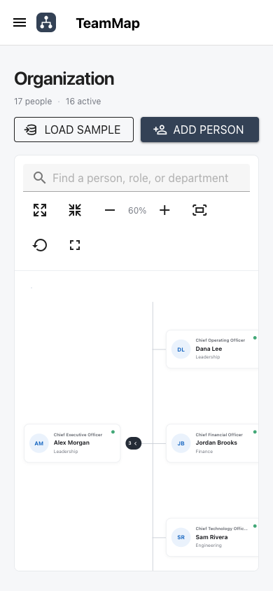

# TeamMap

**Entiende la forma de tu organización en segundos.** TeamMap convierte las relaciones de mando en un organigrama interactivo y mantiene un directorio editable de personas. Todo funciona en el navegador, sin cuentas ni backend: tus datos se quedan en el equipo donde los cargas.

Explora quién reporta a quién, encuentra a una persona por nombre, rol o departamento, y mantén altas, bajas y managers al día. Puedes recorrerlo con los datos ficticios de ejemplo o importar los tuyos desde CSV o una copia JSON.

> **La promesa real:** una herramienta local, rápida y comprensible para una organización pequeña. No es un HRIS multiusuario: no hay inicio de sesión, sincronización entre dispositivos ni servidor que guarde tu información.

## Vista previa

Capturas tomadas desde la aplicación en desarrollo con la organización de ejemplo cargada.

| Organigrama interactivo | Directorio de personas |
|:---:|:---:|
|  |  |

| Organigrama en móvil | Directorio en móvil |
|:---:|:---:|
|  |  |

## Qué puedes hacer

- **Ver la estructura, no solo una lista.** El organigrama se genera desde las relaciones `managerId`. Puedes expandir o contraer ramas, buscar personas —con resaltado y contador de coincidencias—, hacer zoom, ajustar la vista a la pantalla y abrir el modo de pantalla completa.
- **Trabajar una persona a la vez.** Al seleccionar una tarjeta se abre un panel contextual para consultar o editar sus datos, incluido su manager, puesto, departamento, estado y fecha de ingreso.
- **Mantener el directorio al día.** Busca por nombre o correo, filtra por departamento, puesto y estado, y ordena y pagina los resultados. Las acciones destructivas piden confirmación; al eliminar a un manager, sus reportes directos pasan a su propio manager, o al nivel superior.
- **Traer tus datos sin sorpresas.** Importa CSV con relaciones por correo de manager, o restaura una copia JSON versionada. Todo el archivo y el grafo de reportes se validan antes de mostrar una vista previa y reemplazar los datos. Solo se aplica el cambio si la validación completa pasa.
- **Cambiar de dispositivo exportando.** No hay sincronización automática: exporta una copia JSON desde People → Data y restáurala donde la necesites.
- **Usarlo en cualquier tamaño de pantalla.** En escritorio la navegación empieza como una barra compacta de iconos; en móvil se convierte en un cajón temporal y las tablas y el organigrama se adaptan al ancho disponible.

## Privacidad y datos

- La información se guarda en `localStorage` (`teammap.organization.v1`). No se envía a ningún servicio.
- Los datos inválidos o de una versión no soportada no se sobrescriben automáticamente: la app lo informa y te pide confirmación antes de borrarlos o restaurar una copia válida.
- El botón **Load sample** reemplaza la organización actual solo después de pedir confirmación.
- La copia JSON es el mecanismo explícito para mover o respaldar tu información.

## Demo

La versión publicada está en <https://christianjtr.github.io/manage-employees-dashboard>. GitHub Pages publica automáticamente desde GitHub Actions después de validar cada push a `main`.

## Desarrollo

### Requisitos

- Node.js 22.12 o superior (se recomienda Node 24; consulta `.nvmrc`).
- npm.

### Arranque

```sh
npm ci
npm run dev
```

### Verificaciones

```sh
npm run lint
npm run typecheck
npm test
npm run build
npm run preview
```

### Stack

- Vue 3 y TypeScript
- Vite
- Vuetify 4 con tema claro
- Vue Router 4 con rutas hash para GitHub Pages
- Zod 4 para validación en tiempo de ejecución y tipos derivados
- Vitest

## Documentación del proyecto

- `changelog.md` registra los hitos de implementación y sus verificaciones.
- `memory.md` recoge las decisiones duraderas de producto y arquitectura.

## Licencia

Distribuido bajo la [licencia MIT](LICENSE). Puedes usar, modificar y redistribuir el proyecto conservando el aviso de copyright y la renuncia de garantía incluidos.
