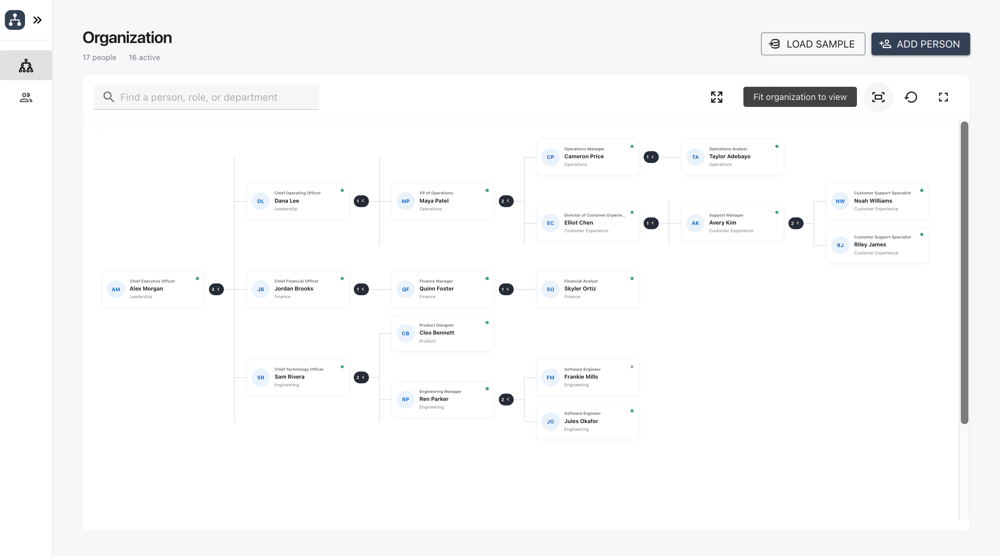
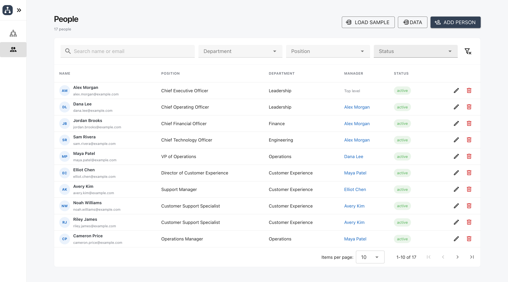
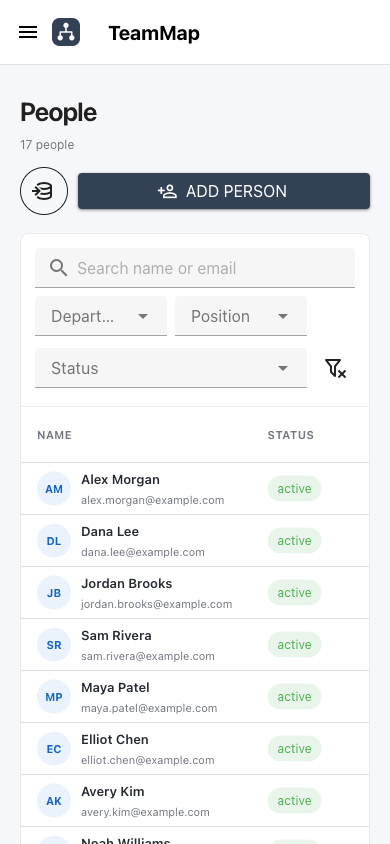

# TeamMap

**Understand the shape of your organization in seconds.** TeamMap turns reporting lines into an interactive org chart and keeps an editable people directory. Everything runs in the browser, with no accounts or backend: your data stays on the device where you load it.

Explore who reports to whom, find someone by name, role or department, and keep hires, leavers and managers up to date. Start with the fictional sample organization or import your own data from CSV or a JSON backup.

> **The real promise:** a local, fast and easy-to-understand tool for a small organization. This is not a multi-user HRIS: there is no sign-in, no cross-device sync and no server storing your information.

## Preview

Screenshots captured from the running development app with the sample organization loaded.

| Interactive org chart | People directory |
|:---:|:---:|
|  |  |

| Org chart on mobile | Directory on mobile |
|:---:|:---:|
|  |  |

## What you can do

- **See the structure, not just a list.** The org chart is generated from `managerId` relationships. Expand or collapse branches, search people with highlighting and a match count, zoom, fit the chart to the screen and open fullscreen mode.
- **Work on one person at a time.** Selecting a card opens a contextual panel to review or edit their details, including manager, position, department, status and start date.
- **Keep the directory current.** Search by name or email, filter by department, position and status, and sort and paginate results. Destructive actions ask for confirmation; deleting a manager promotes their direct reports to that manager's own manager, or to the top level.
- **Bring your own data without surprises.** Import CSV with manager links resolved by email, or restore a versioned JSON backup. The whole file and reporting graph are validated before a preview is shown and before any data is replaced. Changes are applied only if full validation passes.
- **Move between devices by exporting.** There is no automatic sync: export a JSON backup from People → Data and restore it wherever you need it.
- **Use it at any screen size.** On desktop, navigation starts as a compact icon rail. On mobile it becomes a temporary drawer, and both the table and the org chart adapt to the available width.

## Privacy and data

- Data is stored in `localStorage` (`teammap.organization.v1`). It is not sent to any service.
- Invalid data or unsupported versions are not overwritten automatically: the app tells you and asks for confirmation before clearing them or restoring a valid backup.
- The **Load sample** button replaces the current organization only after confirmation.
- The JSON backup is the explicit mechanism for moving or backing up your information.

## Demo

The published version is at <https://christianjtr.github.io/manage-employees-dashboard>. GitHub Pages publishes automatically from GitHub Actions after each validated push to `main`.

## Development

### Requirements

- Node.js 22.12 or newer (Node 24 is recommended; see `.nvmrc`).
- npm.

### Getting started

```sh
npm ci
npm run dev
```

### Checks

```sh
npm run lint
npm run typecheck
npm test
npm run build
npm run preview
```

### Stack

- Vue 3 and TypeScript
- Vite
- Vuetify 4 with a light theme
- Vue Router 4 with hash routes for GitHub Pages
- Zod 4 for runtime validation and inferred domain types
- Vitest

## Project documentation

- `changelog.md` records implementation milestones and verification results.
- `memory.md` records durable product and architecture decisions.

## License

Distributed under the [MIT License](LICENSE). You can use, modify and redistribute the project as long as you keep the included copyright notice and warranty disclaimer.
